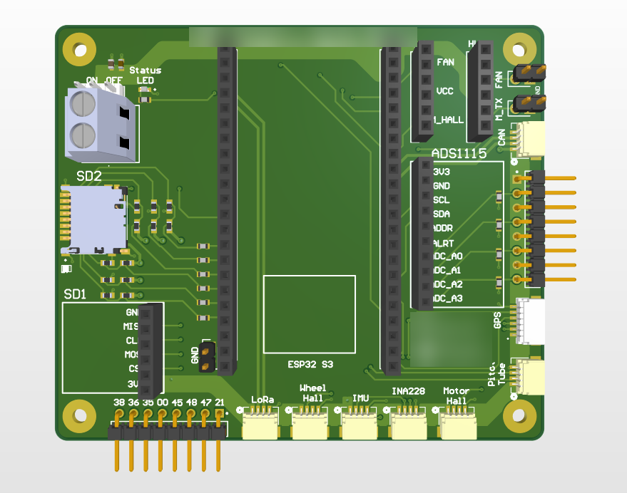
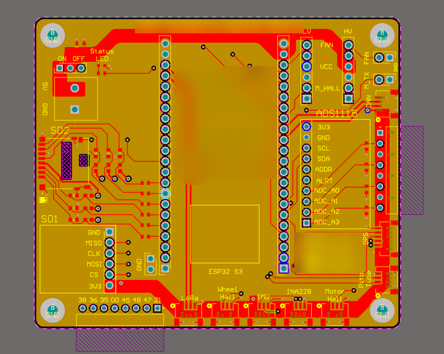

# ESP32-S3 SD Board

A telemetry board built around an ESP32-S3, with a microSD card on the 4-bit SDMMC bus, designed in Altium Designer for a student team's vehicle.

> **Why there are no design files here:** the board belongs to the team, so the schematic, layout files and gerbers stay private. This repo describes the design and what I learned building it.

## At a glance

| | |
|---|---|
| MCU | ESP32-S3 dev module, plugged into two long headers |
| Storage | microSD socket on the SDMMC host in 4-bit mode (CLK, CMD, D0–D3), plus a header for an SPI SD module |
| Sensors and links | LoRa, GPS, IMU, INA228 power monitor, wheel and motor Hall sensors, pitot tube, CAN |
| Analog inputs | ADS1115 4-channel ADC |
| Stack-up | 4 layers: signal / GND / GND / signal |
| Tools | Altium Designer |

## Why 4-bit SDMMC

The simplest way to wire an SD card to a microcontroller is SPI mode, which moves one bit per clock.
The ESP32-S3 has a dedicated SD/MMC host, and in 4-bit mode it moves four bits per clock, so the same card reads and writes several times faster.
On the ESP32-S3 the SDMMC signals go through the GPIO matrix, which left room to choose pins that kept the routing short.

## Layout

Two inner ground planes sit under both outer layers, so every signal, including the SD clock and data lines, has a solid return path right beneath it.
Each sensor gets its own labelled connector along the board edge, so the wiring harness stays tidy.
